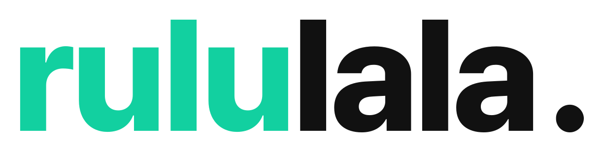

# rululala 디자인

## 로고

현재 사이트의 워드마크는 `rululala.`입니다. `rulu`는 민트 그린, `lala`와 마침표는 검정입니다.

- 웹용 SVG 원본: [wordmark-mint.svg](assets/wordmark-mint.svg)
- GitHub 문서용 흰 배경 SVG: [wordmark-mint-on-white.svg](assets/wordmark-mint-on-white.svg)
- 조직 프로필 이미지: 같은 워드마크를 변형 없이 흰 정사각형 중앙에 배치합니다.
- 사이드 내비게이션의 작은 표시는 민트 `r`와 검정 마침표입니다.

기존 `icon.svg`, `icon.png`, `icon-on-white.png`, `wordmark.svg`, `wordmark.png`, `wordmark-on-white.png`는 이전 보라 브랜딩 자료입니다. 현재 로고로 사용하지 않습니다.

## 색상

| 용도 | 색상 |
| --- | --- |
| 로고·카드 상단·강조 버튼의 민트 그린 | `#12D0A0` |
| 보조 초록 강조 (HOT·링크·가격) | `#0CAA7D` |
| 로고·본문·기본 버튼의 검정 | `#111111` |
| 종이 질감 페이지 배경 | `#FDFCF9` |
| 카드·로고 이미지 배경 | `#FFFFFF` |
| 연민트 카드 배경 | `#EEF8F2` |
| 민트 테두리 | `#D5EBE4` |

현재 `style.css`의 `body.mint`에서는 기본 버튼·텍스트 변수가 검정으로 설정되고, 민트 강조는 각 요소에도 지정되어 있습니다. 색상을 바꿀 때는 SVG와 관련 CSS를 함께 확인합니다.

지도 핀의 보라·파랑, 별점의 노랑 등 정보 구분용 색상은 로고 색상과 별개입니다.

## 서체

- 사이트 본문: Pretendard Variable
- 워드마크: SVG 경로로 고정된 글자 형태
